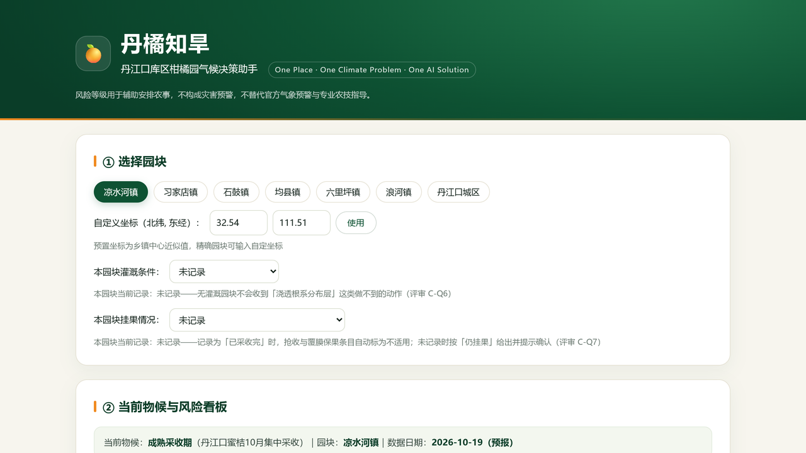
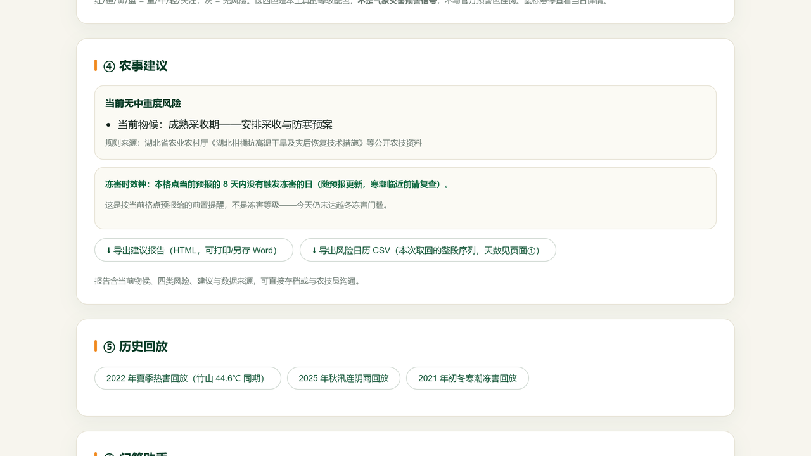

# 丹橘知旱 · 丹江口库区柑橘园气候决策助手

> AI4Climate 全球青年气候解决方案挑战赛参赛项目 · 团队 **沧浪舟** · 开放选题 / 气候适应与韧性
>
> **One Place · One Climate Problem · One AI Solution** —— 一个地方（丹江口库区）、一个气候问题（极端旱涝下的柑橘生产）、一个 AI 解决方案（物候匹配的气候风险决策助手）。

**在线体验（GitHub Pages）**：https://pawnnwap.github.io/danju-zhihan/

## 一、真实问题

丹江口水库是南水北调中线核心水源区，库周湖北省丹江口市有约 **30 万亩柑橘、约 10 万果农**。近年极端气候频发：

- 2022 年长江流域发生 1961 年以来最强高温干旱，十堰竹山录得 **44.6℃** 刷新湖北纪录，中国气象局首次派飞机在丹江口汇水流域人工增雨；本项目所选典型园块（凉水河镇）当年夏季 **≥35℃ 达 30 天、极端最高 40.9℃**。
- 文献记载：湖北武穴柑橘产区 2008—2023 年累计 38 次气象灾害事件，"花期水分亏缺导致落花率增加 32%-45%"（夏润林，《气象灾害对武穴柑橘产量的影响及其对策分析》，Agricultural Science 2025, 8(8)，DOI 10.12238/as.v8i8.3240，2026-10-13 检索）。**该研究区不是丹江口库区，且为开放获取期刊、未经第三方复核——本项目只把它当作问题动机，不当作本工具的效果证据**；2025 年汉江又发生 64 年来最密集秋汛。
- 果农凭经验应对，缺少针对柑橘物候、贴合库区小气候的风险提示工具。

## 二、方案

输入园块位置 → 自动完成「**物候期识别 → 四类风险指标计算 → 农事建议生成**」→ 支持自然语言追问。

四类风险：高温热害 / 干旱 / 花期·幼果低温（倒春寒）/ 越冬冻害。

另有两条**园块条件输入**决定动作能不能落地：本园块灌溉条件、本园块挂果情况（有/无/未记录，只存本机、按园块分别记）——记录为"无灌溉"或"已采收完"时，需水或需抢收的动作自动移出可执行段并写明不适用的原因；冻害的执行时效附带一把"距降温 N 天"的钟，下次降温日直接取引擎对未来预报日的判级结果，农户据此判断自己处在灌水窗口内还是已经太晚。





## 三、AI 承担的具体任务

1. **确定性风险引擎**（`phenology.js`）：公开气象数据 + 柑橘物候规则表 + 分级阈值，输出逐日风险等级与触发依据——计算可核验；
2. **DeepSeek 大模型解释层**（可选接入）：将风险指标、物候期、农技规则库作为上下文，生成个性化农事建议与问答，回答须引用数据日期；LLM 只做信息转译与解释，**不做数值预测**。

数据来源：[Open-Meteo](https://open-meteo.com/)（ERA5-Land 再分析 + ECMWF 预报，浏览器直连、免密钥）。
规则来源：湖北省农业农村厅《湖北柑橘抗高温干旱及灾后恢复技术措施》等公开农技资料。

## 四、验证

- **历史回测**：`tools/backtest.py` 用独立 Python 实现复算 2022 年热害与干旱（喂数带 35 天 warm-up，与产品运行时一致）——热害首个"重"级提示（2022-08-04，39.2℃）比峰值（08-07，40.9℃）**提前 3 天**、"重"级共 13 天；该时效由**单日 ≥39℃ 阈值**贡献（连续日数升级在同过程另贡献 3 天，最早出现在峰值之后，二者不混记）。干旱同区间为"重"1 天／"中"55 天、首个提示 2022-06-01（＝报告窗口首日，同一序列上 05-28 起已连续带级，这个日期**不含提前量含义**，时效主张只挂热害）、最长连旱 12 天（该区间完全落在蒸散口径定标段之外，是样本外结果；"重"级需降水口径佐证，故 2022 年夏旱在该格点主要落"中"级）；基线与逐项盘点见 `docs/02-数据与AI说明.md`。页面内置 2022 热害 / 2025 秋汛 / 2021 冬寒潮三个回放场景。
- **等价性闸门**：`tools/parity_check.py` 将前端 JS 引擎与 Python 实现逐日对拍（4 个真实窗口 442 天 + 37 组阈值边界合成用例 + 1302 个逐日比对点位的单调性扫描（5 条轴）+ 物候表全年无洞 + 阈值常量三方绑定 + 四类风险的归因文案逐字符比对＋5 组"诚实限定词"用例；扫描与真实窗口共用 warm-up 准则，并断言"出级点位"单轴≥50%、整体≥70%，防止两侧都不判级的一致充数），不一致即非零退出、禁止提交；`tools/mutation_test.py` 反向自证四道闸门（44 个注入变异全部执行且拦下，含往闸门自己身上打的四类——闸门被削弱后"声明自己核了多少"的计数会掉，按拦下处理）。
- **一键全绿与可追溯记录**：`python tools/check_all.py` 按固定顺序跑六件事（对拍、头条回归、基线/留出、前端烟测、变异自证、材料一致性），**全部通过才把结果写进 `tools/GATES.json`**——该文件记录被验证的 commit 短号、工作树是否干净、冻结输入的格点与 `pulled_at_utc`、以及每道闸门自己声明的核查条数；任一失败即退出 1 且不覆盖上一次成功记录。提交前拦截：**尚未生效**——`.githooks/pre-commit` 已就位，但需要仓库所有者执行一次 `git config core.hooksPath .githooks` 才真正拦提交（本项目不自动改 git 配置；在那之前，"全绿才提交"靠人工跑 `check_all.py` 保证，材料不把它写成已启用的机制）。
- **页面可追溯**：页脚与导出报告印 `规则 r5-20261013｜…` 一类的判级口径串（`phenology.js:ruleStamp()`），用户截图/反馈能对应到具体规则版本；该串的版本号与定标段年份由 `parity_check.py` 第 3 层与 `baseline_stats.py` 的年份区间绑定，改一处即对拍失败。
- **离线可复算**：输入序列已冻结在 `tools/fixtures/liangshuihe_2016_2025.json`（3653 天，实际命中格点与拉取时间记录于文件 meta），复算头条数字不需联网：`python tools/backtest.py --fixture tools/fixtures/liangshuihe_2016_2025.json --start 2022-06-01 --end 2022-09-30 --check`
- **90 天试点计划**：与库区 1–2 家柑橘合作社/乡镇农技站试用，记录建议采纳率、满意度与追问次数（见 `docs/03-验证计划.md`）。

## 五、运行

纯静态站点，无需构建：

```bash
# 本地运行
python -m http.server 8000
# 打开 http://127.0.0.1:8000
```

回测脚本：

```bash
python tools/backtest.py            # 默认凉水河镇
python tools/backtest.py 32.54 111.51
```

演示视频（可选，需 ffmpeg + Edge TTS〔或 piper 兜底〕+ 本机 Edge）：

```bash
python tools/capture_assets.py      # 抓 2x 真机截图到 docs/frames/v2/
python tools/make_video.py          # 逐帧渲染 + 配音对齐 → docs/demo-video.mp4
python tools/make_video.py --still problem 6.5   # 只出一帧，调版式用
```

> 片子不录制屏幕，而是用 Pillow 按分镜逐帧绘制（`tools/video/scenes.py`），
> 配音默认走 Edge TTS 的 `zh-CN-YunjianNeural`（`TTS_VOICE` 可换音色，失败自动回落 piper），
> 音画时间线由配音时长反推；片中数字全部取自
> `tools/fixtures/` 与产品「2022 年夏季热害回放」的实拍输出。

## 六、安全边界

风险等级用于辅助安排农事，**不构成灾害预警**，不替代官方气象预警与专业农技指导。再分析/预报数据存在不确定性，重要农事决策请结合当地气象部门信息。

**可持续性口径（不粉饰）**：**12 个月内收入为 0**（含单次劳务收费），赛道选择为"可自助复算的开源作品 + 移交包"，不自称公共基础设施；资金渠道按举证标准逐条核对，当前结论是"**暂无已核验渠道**"。试点现金封顶 **3400 元**（误工补偿若无法合规列支则自动降至 2200 元）、项目人工时基线 85–95 小时（分项可加），二者都写有超支砍序与退出触发清单（详见 `docs/03-验证计划.md` §2、§8）。 试点的逐周周历与工时台账落在 `docs/04-试点周历与台账.md`（退出触发④的计量件）。

## 文档

- [项目说明](docs/01-项目说明.md)
- [数据与 AI 说明](docs/02-数据与AI说明.md)
- [验证计划](docs/03-验证计划.md)
- [试点周历与台账](docs/04-试点周历与台账.md)
- [演示视频（85 秒，1080p，中文配音＋烧录字幕）](https://pawnnwap.github.io/danju-zhihan/docs/demo-video.mp4)｜[仓库内文件](docs/demo-video.mp4)

> `tools/GATES.json` 是**本地一键复算的记录文件**（记 `commit` 短号与工作树是否干净）；其中的 commit 指运行那一刻的本地工作副本，不一定对应远端提交。评委复现请直接运行 `python tools/check_all.py`，跑完会重写该文件。
- [参赛 PPT](丹橘知旱-参赛PPT.pptx)
- [社区作品帖](https://deepseek.club/topic/5043)

## 团队

沧浪舟 · 个人参赛 · 2026-10

## 开源许可

代码按 **MIT** 发布（见 [LICENSE](LICENSE)）——任何人可 fork、修改、自部署、再分发；文档与规则库表述按 **CC BY 4.0** 署名共享。两条边界随许可一并写明：运行时气象数据来自 Open-Meteo 非商业免费层、数据本体 CC BY 4.0（署名义务传导给每一位再利用者，页脚已按此署名，商用部署需自行取得数据授权）；农技规则出处为湖北省农业农村厅等机构的公开文件，本仓库只做引用与转述。此前材料写"开源可自部署"时仓库尚无 LICENSE 文件，这一空缺已由本节补上。
